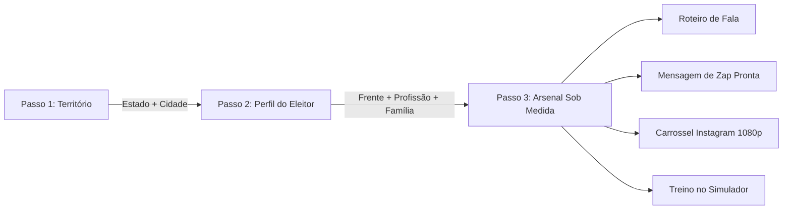

# 🌟 BORA 13 — DOCUMENTO MESTRE DE CONTEXTO DO PRODUTO (UX/UI, ARQUITETURA & INTENÇÃO)

> **Documento de Contexto Integral para Modelos de IA (ChatGPT, Claude, Gemini)**  
> **Aplicação**: Bora 13 — Guia Cidadão de Diálogo Popular  
> **Posicionamento**: Iniciativa Cidadã & Voluntária • **Não oficial, sem vínculo com o PT ou Casa 13** • Feita para somar na causa  
> **Acesso em Produção**: [www.gigantera.xyz/bora](https://www.gigantera.xyz/bora)  
> **Finalidade**: Permitir que qualquer IA compreenda imediatamente a identidade visual, a arquitetura técnica, os fluxos de navegação, a psicologia de conversão e as decisões de UX/UI do aplicativo para propor melhorias, novos componentes, refatorações ou estratégias narrativas com 100% de precisão contextual.

---

## 1. 🎯 INTENÇÃO DO PRODUTO & MISSÃO ESTRATÉGICA

### O Problema Central
Campanhas eleitorais e debates cívicos costumam ser contaminados por polarização tóxica, agressividade partidária e sobrecarga de informações abstratas. Voluntários e cidadãos comuns querem conversar com amigos, parentes e colegas de trabalho, mas travam por medo de briga, falta de argumentos na ponta da língua ou incapacidade de conectar grandes números macroeconômicos à vida real do interlocutor.

### A Tese de Produto
O **Bora 13** não é um panfleto digital nem um site de propaganda comum. É uma **plataforma cívico-tecnológica de escuta ativa, acolhimento e conversão de votos** desenhada para o segundo turno. Seu lema operacional é: **"A complexidade deve existir no sistema para que o usuário sinta apenas facilidade e acolhimento."**

### As 4 Frentes Estratégicas de Conversão (Tática dos 4 Votos)
Baseado nos estudos eleitorais de 2º turno, o app segmenta os interlocutores em 4 perfis prioritários:
1. **Frente 01 — Ex-Lula Frustrado com Preços (Prioridade Máxima)**:
   - *Dor*: Sente o aperto no mercado, acha que as coisas demoram a melhorar.
   - *Regra de Ouro*: **Nunca diminuir a dor do interlocutor.** Primeiro acolher a angústia das compras; depois demonstrar a queda na cesta básica (óleo, leite, carnes) e o aumento real do salário mínimo acima da inflação.
2. **Frente 02 — Terceira Via & Indeciso**:
   - *Dor*: Cansaço da polarização e receio de instabilidade institucional.
   - *Regra de Ouro*: Fazer perguntas socráticas sobre estabilidade democrática, valorizar a responsabilidade fiscal com justiça social e alertar para o descontrole do projeto adversário.
3. **Frente 03 — Abstenção / Eleitor 70+**:
   - *Dor*: Desânimo com a política, dificuldade de locomoção, sensação de que seu voto não muda nada.
   - *Regra de Ouro*: Mobilizar por afeto e conquistas palpáveis da família (Farmácia Popular 100% gratuita para pressão/diabetes, Pé-de-Meia dos netos, reajuste das aposentadorias).
4. **Frente 04 — Nulo, Branco & Desiludido ("O Menos com Flávio")**:
   - *Dor*: Crença cínica de que "todos os políticos são iguais".
   - *Regra de Ouro*: Virar voto mostrando o **MENOS**. Provar com registros históricos os cortes e perdas que a família sofrerá caso a oposição assuma (fim da Farmácia Popular, desvinculação do salário mínimo, corte de verbas da educação básica).

---

## 2. 🎨 SISTEMA VISUAL, ESTÉTICA & DIREÇÃO DE ARTE

### Filosofia Estética: Concretismo Editorial Brasileiro & Awwwards
A identidade visual rejeita o padrão corporativo cinza do Vale do Silício e a estética tradicional de campanhas partidárias poluídas. Inspira-se no **Concretismo Modernista Brasileiro** (Niemeyer, Burle Marx), no jornalismo analítico humanista (Revista Piauí) e no design suíço de alto impacto tipográfico:
- **Modo Padrão**: Claro (Solar, editorial, jornalístico, caloroso e confiável).
- **Modo Noturno (Dark Mode)**: Suportado com alternador instantâneo sincronizado com shaders WebGL.
- **Micro-interações Hápticas**: Todo clique, transição de aba, cópia de link ou geração de card emite micro-sons procedurais gerados matematicamente pela Web Audio API nativa (zero latência, sem arquivos `.mp3`).

### Paleta Cromática Oficial (Tokens CSS)
- **Vermelho Rubro Oficial (`--casa-red`)**: `#C52229` (Acento cívico da esperança e da Casa 13).
- **Dourado Solar (`--casa-gold`)**: `#F59E0B` (Alerta positivo, prosperidade, oportunidades).
- **Verde Brasil (`--casa-green`)**: `#10B981` (Selo de verificação, dados auditados, conquistas sociais).
- **Azul Cívico (`--casa-blue`)**: `#1D4ED8` (Institucionalidade, estabilidade e sobriedade).
- **Fundo da Página (`--bg-page`)**: `#F8FAFC` (Light) / `#0B0F19` (Dark).
- **Superfícies de Cards (`--bg-surface`)**: `#FFFFFF` (Light) / `#131A29` (Dark).
- **Bordas e Linhas de Grid (`--border`)**: `#E2E8F0` (Light) / `rgba(255, 255, 255, 0.09)` (Dark).
- **Fita Multicolorida (`.casa-ribbon`)**: Faixa de 4px no topo com gradiente contínuo Vermelho $\rightarrow$ Dourado $\rightarrow$ Verde $\rightarrow$ Azul.

### Camada Artística WebGL & Shaders Cinéticos (`ArtisticCanvas.tsx`)
No fundo da aplicação opera uma cena Three.js de baixo impacto computacional com um **Shader GLSL customizado**:
- Uma **fita ondulante contínua** simula o tecido cívico nacional ondulando em tempo real.
- Interage sutilmente com o movimento do ponteiro do mouse (`uPointer`).
- Adapta a iluminação volumétrica e o gradiente cromático ao tema claro/escuro (`uDarkMix`).

---

## 3. 🗺️ ARQUITETURA DE INFORMAÇÃO & FLUXO DE NAVEGAÇÃO

O aplicativo é estruturado como uma **Single Page Application (SPA)** de alta performance (`app/page.tsx`) com renderização estática turbinada por Turbopack no Next.js 16.

### Estrutura Global de Navegação
1. **Desktop**: Floating Dynamic Island superior fixa (`NavigationHeader.tsx`) contendo Logo Casa 13, Pills contextuais de UF/Profissão ativas com atalho de edição rápida, 5 destinos de alto nível com badges editoriais, ativador de som procedural, alternador de tema e botão de instalação PWA.
2. **Mobile**: Dock de polegar flutuante na base da tela (`MobileDock.tsx`) com blur translúcido (`backdrop-blur-lg`), 5 destinos essenciais ergonômicos e feedback tátil por áudio procedural.

### Os 5 Destinos Focados da Aplicação (Redesign Cognitivo)
```
┌────────────────────────────────────────────────────────────────────────┐
│                   BORA 13 — 5 DESTINOS DE INTENÇÃO CLARA               │
├───────────────┬────────────────────────────────────────────────────────┤
│ 1. inicio     │ Ponto de Partida Editorial, Radar Territorial HUD      │
│               │ com Mapa Interativo (Passo 1) e Memória Persistente    │
├───────────────┼────────────────────────────────────────────────────────┤
│ 2. preparar   │ Espaço de Trabalho de Missão Dedicado: O Funil Guiado  │
│               │ da Virada em 3 Passos (Território → Perfil → Arsenal)  │
├───────────────┼────────────────────────────────────────────────────────┤
│ 3. treinar    │ Dojô de Conversas Reais (Tio Roberto, Marcos, Dona     │
│               │ Neide) com neurociência e feedback imediato de empatia │
├───────────────┼────────────────────────────────────────────────────────┤
│ 4. explorar   │ Hub de Inteligência Territorial e Factual:             │
│               │ Sub-abas: [Mapa do Brasil | Dossiê 27 UFs | Fatos IBGE]│
├───────────────┼────────────────────────────────────────────────────────┤
│ 5. estudio    │ Estúdio de Criação Visual 1080p, Carrosséis Narrativos │
│               │ de 5 Atos, Copy Multiplataforma e Zap em 1 Toque       │
└───────────────┴────────────────────────────────────────────────────────┘
```

---

## 4. 🚀 O FUNIL DA VIRADA EM 3 PASSOS (`TailoredMissionFunnel.tsx`)

O coração do aplicativo é o **Funil Guiado da Virada**, que elimina a sobrecarga cognitiva do voluntário transformando dados em um roteiro prático sob medida:



### Passo 1: Território Ativo (Estado $\rightarrow$ Cidade)
- O usuário escolhe o Estado (UF) no mapa interativo ou lista rápida.
- Seleciona ou digita a Cidade desejada.
- O sistema ancora automaticamente estatísticas oficiais do território: novos empregos com carteira assinada (Caged), número de estudantes na poupança Pé-de-Meia, famílias no Bolsa Família e beneficiários do Farmácia Popular.

### Passo 2: Perfil do Interlocutor no Território
- **Frente de Conversão**: Seleciona entre Ex-Lula Frustrado, Terceira Via / Indeciso, Abstenção / 70+ ou Nulo/Branco.
- **Profissão / Atividade**: Seleção rápida em chips (Motorista de App, Comerciante, Professor, Pedreiro, Enfermeiro, MEI, Aposentado) ou campo de texto livre com **inferência semântica automática de tags**.
- **Realidade Familiar (Flags de Empatia)**: Seleção por toggles rápidos:
  - *Tem idosos em casa* (ativa alertas sobre Farmácia Popular e BPC);
  - *Tem jovens estudando* (ativa argumentos do Pé-de-Meia);
  - *Depende do SUS* (ancora dados de vacinas e cirurgias eletivas);
  - *Recebe benefício social*;
  - *Tem pessoa com deficiência (PCD)*.

### Passo 3: Arsenal Sob Medida & Ações Conectadas
O motor agêntico (`createCustomizedConversationPlan`) gera instantaneamente:
1. **Gancho de Acolhimento Personalizado**: Como iniciar a conversa sem parecer um militante chato, reconhecendo a legitimidade da preocupação do interlocutor.
2. **Regra de Ouro & O Que NUNCA Dizer**: Blindagem contra armadilhas de confronto que fecham o diálogo.
3. **As 3 Provas Concretas do Bolso na Cidade**: Dados auditados hiper-locais com fontes transparentes.
4. **Bate-Pronto da Objeção ("Se falar X, responda Y")**: Resposta serena e desarmadora para a frase mais comum daquele perfil.
5. **Alerta de Perdas ("O Menos com Flávio")**: O que aquela categoria ou família perde diretamente caso a oposição seja eleita.
6. **Ações em 1 Clique**:
   - 📲 **Mandar no WhatsApp**: Abre o app nativo ou web com mensagem humanizada pronta e diagramada;
   - 🎨 **Abrir no Estúdio**: Transfere todo o contexto para o gerador de artes visuais;
   - 💬 **Praticar no Simulador**: Carrega o avatar correspondente para teste antes do diálogo real;
   - 🔗 **Copiar Link da Missão**: Deep-link com URL parametrizada (`?state=SP&city=Campinas&front=ex_lula&occ=Motorista`) para sincronizar outros voluntários.

---

## 5. 🔬 DETALHAMENTO DAS SEÇÕES & EXPERIÊNCIA DE USO

### 1. Radar (`RadarSection.tsx`)
- **Hero Editorial**: Manchete de alto impacto com tipografia refinada e contadores de mobilização.
- **Mapa Interativo do Brasil (`BrazilMap.tsx`)**: SVG vetorial interativo com hover states, destaque de capitais e seleção instantânea de UFs.
- **Painel de Próximo Passo Inteligente (`getSmartNextStepRecommendation`)**: O orquestrador analisa a memória de trabalho e sugere a próxima ação mais eficiente (ex: se o usuário já escolheu SP, sugere mandar as conquistas de SP no Zap).
- **Atalhos Rápidos**: Botões para explorar os 4 votos, ver dados de alimentos e baixar o PWA.

### 2. Meu Estado (`TerritorySection.tsx`)
- Dossiê detalhado dos 27 estados da federação.
- Táticas regionais customizadas (ex: no Nordeste, foco na transposição e Pé-de-Meia; em SP/Sudeste, reindustrialização, crédito MEI e medicamentos contínuos).
- Botão direto para gerar card oficial com os números do estado selecionado.

### 3. Quem Abordar (`ProfileSection.tsx`)
- Interface de perfilamento empático com régua de resistência (Níveis 1 a 4: Simpatizante, Curioso, Cético, Oposição Dura).
- Seletor das 4 Frentes de Conversão com cards expansíveis contendo citações de pensamento típico e causa raiz do sentimento.
- Recomendações instantâneas de roteiro dialógico com base nas tags selecionadas.

### 4. Dojô de Conversas da Vida Real (`ConversationSimulator.tsx`)
- **Cenário 1 — Tio Roberto no Almoço de Domingo**: Aposentado de 64 anos que reclama da inflação e repete mensagens de grupos.
- **Cenário 2 — Marcos, Motorista de Aplicativo**: Autônomo de 38 anos com medo de imposição de CLT sobre seu ganho diário.
- **Cenário 3 — Dona Neide, Cuidadora e Vizinha**: Senhora que cuida da mãe acamada dependente de BPC assustada com boatos de cortes.
- **Mecânica de Jogo**: Para cada cenário, o usuário escolhe entre 3 opções de fala (Acolhedor, Confrontador ou Passivo). O sistema avalia a escolha com uma pontuação de 0 a 100, exibe um feedback pedagógico imediato e uma dica tática para fixação.

### 5. Fatos do Bolso & Roleta da Verdade (`QuickArgumentView.tsx`)
- Acervo completo de provas materiais divididas em 6 categorias: Alimentação & Cesta Básica, Emprego & Renda, Saúde & SUS, Educação & Juventude, Direitos & Previdência, Habitação & Crédito.
- Indicadores auditados com citações de órgãos oficiais (IBGE, DIEESE, Banco Central, Caged, Ministérios).
- Cada fato possui botão para abrir diretamente o gerador de artes visuais ou copiar a prova para a área de transferência.

### 6. Estúdio de Criação de Peças (`PostStudioSection.tsx`)
Renderizador gráfico no navegador baseado na **HTML5 2D Canvas API**:
- **Formatos de Exportação**:
  - Retrato Feed Instagram (4:5 — $1080 \times 1350$ px);
  - Quadrado Feed (1:1 — $1080 \times 1080$ px);
  - Story / Reel / WhatsApp Status (9:16 — $1080 \times 1920$ px);
  - Carrossel Narrativo Completo de 5 Lâminas.
- **Os 5 Atos Narrativos do Carrossel**:
  1. *Ato 1 (Capa)*: Manchete intrigante, selo oficial e gancho emocional;
  2. *Ato 2 (A Grande Métrica)*: Número gigante em destaque com indicador auditado;
  3. *Ato 3 (Comparativo Dialético)*: Boato vs. Registro Histórico;
  4. *Ato 4 (A Vida Real no Bolso)*: O impacto nas contas do mês da família;
  5. *Ato 5 (Manifesto & Ação)*: Chamada para a virada e link cívico.
- **5 Temas Visuais Selecionáveis**:
  - `brasil-editorial`: Papel algodão off-white com arcos geométricos sutis;
  - `brasil-vibrante`: Cores quentes e solares de alta vibração popular;
  - `dark-moderno`: Fundo escuro tecnológico com acentos luminosos;
  - `concretismo-puro`: Grid modernista rígido e elegante;
  - `jornalismo-investigativo`: Estética de manchete com carimbos e papel envelhecido.
- **Gerador Procedural de Textura**: Algoritmo que aplica grão estocástico analógico aos pixels do canvas para eliminar o aspecto plástico artificial.
- **Exportação**: Download instantâneo da lâmina ativa em PNG ou pacote completo com todos os 5 slides compactados em arquivo `.ZIP` via JSZip.
- **Gerador de Copy Multiplataforma**: Abas com textos formatados e ajustados para Instagram (com hashtags cívicas), WhatsApp (com negritos e quebras de linha afetuosas), Stories e Threads.

---

## 6. 🧠 ORQUESTRADOR AGÊNTICO & MEMÓRIA DE TRABALHO (`agenticOrchestrator.ts`)

A persistência de contexto entre diferentes partes da interface é gerida pela estrutura **`AgenticWorkingMemory`**:

```typescript
export interface AgenticWorkingMemory {
  selectedUF?: string;                     // Ex: 'SP'
  selectedCity?: string;                   // Ex: 'Campinas'
  occupation?: string;                     // Ex: 'Motorista de App'
  profileTags: ProfileTag[];               // Ex: ['autonomo', 'combustivel']
  rejectionLevel: number;                  // 1 a 4
  activeFrontId?: 'ex_lula' | 'terceira_via' | 'abstencao_70' | 'nulo_branco';
  familyFlags: {
    hasElderly: boolean;
    hasChildren: boolean;
    dependsSUS: boolean;
    receivesBenefit: boolean;
    hasPCD: boolean;
  };
  activeArgument: Argument | null;
  activeOpportunity: Opportunity | null;
  currentPreset: PostPresetData | null;
  soundEnabled: boolean;
}
```

### Pontes de Contexto Ativas
- Se o usuário filtra uma cidade ou frente no **Radar**, ao clicar em "Estúdio", o post já nasce com os dados daquela cidade e perfil.
- Se o usuário escolhe "Motorista de App" no **Funil**, ao clicar em "Simulador", o cenário abre automaticamente no diálogo com o motorista Marcos.
- Se o usuário clica em "Mandar no Zap", a mensagem já é escrita conjugando o nome da cidade com a dor da categoria selecionada.

---

## 7. 💻 STACK TÉCNICA & ENGENHARIA "PONYTAIL"

O projeto segue rigorosamente o princípio da **Escada da Preguiça (Laziness Ladder)**: alavancar o máximo de recursos nativos dos navegadores modernos antes de considerar instalar bibliotecas de terceiros:
- **Next.js 16.4.0 (Turbopack)** + React 19 + TypeScript Strict Mode.
- **Tailwind CSS v4**: Tokens utilitários modernos e variáveis nativas do CSS.
- **Three.js + GLSL Shaders**: Cenário WebGL leve rodando como plano de fundo artístico cinético.
- **Web Audio API**: Geração de áudio procedural e haptic feedback (zero dependências de pacotes de áudio ou arquivos mp3 de mídia pesados).
- **HTML5 Canvas 2D**: Renderização e exportação gráfica de cards 1080p direto no cliente (sem servidor backend ou Puppeteer).
- **Web Speech API**: Leitura de argumentos por voz nativa para acessibilidade em campo.
- **PWA Nativo**: Service Worker autônomo com cache offline e suporte a instalação em tela inicial (Android e iOS).

---

## 8. 📋 DIRETRIZES PARA QUALQUER IA QUE ATUAR NESTE PROJETO

Ao ser consultada para criar código, sugerir melhorias de UX, refatorar componentes ou propor novas narrativas para o **Bora 13**, a IA deve seguir as seguintes diretrizes:

1. **Nunca Quebrar o Tom de Acolhimento**: Todas as copys, respostas e roteiros devem respeitar a dor real do trabalhador. Jamais adote postura arrogante, sectária ou punitiva contra indecisos ou críticos.
2. **Preservar a Performance & Laziness Ladder**: Prefira sempre soluções usando APIs nativas da Web (Canvas, Web Audio, CSS nativo) antes de sugerir pacotes npm externos.
3. **Respeitar os Tokens do Design System**: Use as variáveis `--casa-red`, `--casa-gold`, `--casa-green`, `--bg-page` e as classes `.card-clean`, `.btn-pt`, `.chip` já padronizadas no `globals.css`.
4. **Pensar no Mobile First**: A maioria absoluta dos voluntários em campo acessa o site pelo smartphone no transporte público, na calçada ou na mesa de almoço. Os elementos devem ser amigáveis ao polegar e ter áreas de toque generosas (mínimo de 44px de altura).
5. **Basear-se Sempre em Fontes Oficiais**: Qualquer dado ou argumento novo deve vir acompanhado de fonte auditada e verificável (IBGE, DIEESE, Banco Central, Caged ou Diário Oficial).
